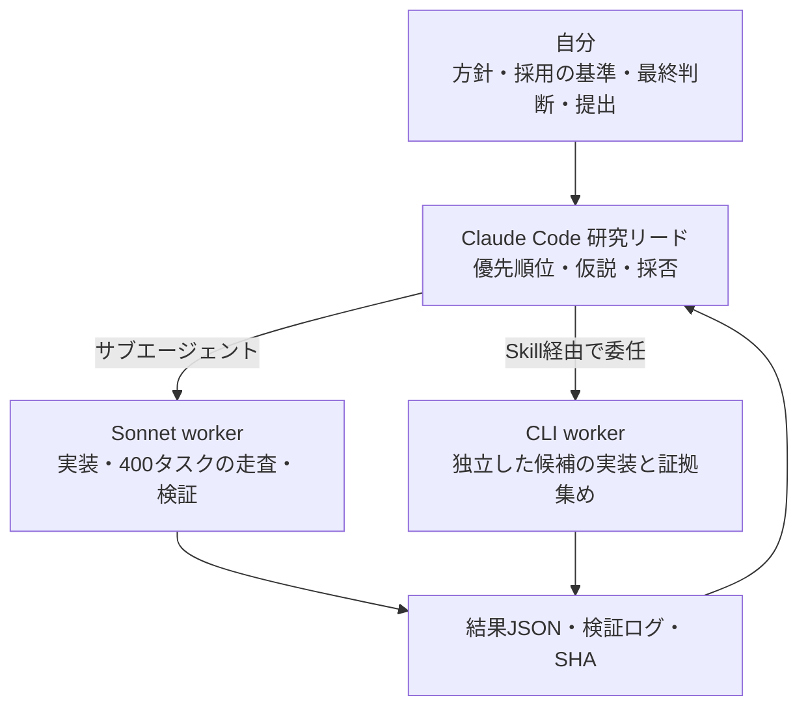

# Kaggle Competitions

> Solutions and agent workflows from my Kaggle competitions (Competitions Expert / Notebooks Expert, started June 2026, 3 bronze medals). In NeuroGolf, ROGII and RSNA I ran Claude Code as a research lead that delegated implementation to Sonnet subagents and external CLI workers, with project skills and fixed validation gates. I set the direction, the acceptance rules and the final calls.

Kaggleの大会に取り組んだ記録です。2026年6月に始め、5か月で **Competitions Expert / Notebooks Expert** になりました。

- Kaggle: [yuu111111111](https://www.kaggle.com/yuu111111111)
- Competitions: 銅メダル3（3,204位 / 221,861人）
- Notebooks: 銀メダル1・銅メダル4（1,264位 / 59,492人）

## 成績

| 大会 | 種類 | 順位 | 上位 | 結果 |
| --- | --- | --- | --- | --- |
| [ROGII Wellbore Geology Prediction](rogii-wellbore/) | 時系列・地質の逆推定 | 437 / 6,125 | 7.1% | 🥉 銅 |
| [NeuroGolf 2026](neurogolf-2026/) | 最小のニューラルネット設計（ONNX） | 275 / 2,963 | 9.3% | 🥉 銅 |
| [Kaggriculture](kaggriculture/) | 対戦型エージェント | 991 / 10,148 | 9.8% | 🥉 銅 |
| [RSNA Knee Abnormality Detection](rsna-knee/) | 医用画像（膝MRI） | 426 / 6,425 | 6.6% | 最終結果待ち |
| Pokémon TCG AI Battle | 対戦型エージェント | 802 / 6,807 | 11.8% | （メダル対象外） |
| [Orbit Wars](orbit-wars/) | 対戦型エージェント | 748 / 4,730 | 15.8% | — |

順位はKaggleの表示（2026-10-23時点）。RSNAは非公開順位の発表前です。

## Claude Codeで研究チームを組む

NeuroGolf・ROGII・RSNAでは、Claude Codeを「研究リード」にして、実装と検証を下のエージェントに任せる体制を組みました。詳しくは [CLAUDE_CODE.md](CLAUDE_CODE.md)。

- **役割の分離**: リードは「何を試すか」「採用するか」だけを決め、workerは決めない。workerの結果は判断ではなく証拠として受け取る（[neurogolf-worker](neurogolf-2026/.claude/agents/neurogolf-worker.md)）。
- **手順のSkill化**: 監査・候補の統合・公開コードの取り込み・提出などを8つのプロジェクトSkillにし、毎回同じ検査を通す（[`.claude/skills/`](neurogolf-2026/.claude/skills/)）。
- **外部エージェントへの委任**: SkillからCLIのコーディングエージェントを並列に起動し、決まった形式のJSONで結果を返させる。基準ファイルのSHAが変わっていないか、禁止操作がないかを自動で確認してから採否を決める（[neurogolf-delegate-codex](neurogolf-2026/.claude/skills/neurogolf-delegate-codex/SKILL.md)）。
- **大会をまたいだ学習**: NeuroGolfの上位チームの解法記事から、分野に依存しない進め方を抜き出し、次のROGIIの `CLAUDE.md` のルールにした（[CLAUDE.md](rogii-wellbore/agent-workflow/CLAUDE.md)、[移植メモ](rogii-wellbore/agent-workflow/NEUROGOLF_TRANSFER_NOTES.md)）。

## 自分が決めたこと

エージェントは手を動かしますが、方向を間違えることもあります。次の判断は自分が出しました。

- **丸暗記の禁止**（NeuroGolf）: 既知の例を丸暗記するモデルは、ローカルでは全問正解でも非公開テストで7,133点まで落ちた。以後、丸暗記パターンの検出を全提出の必須検査にした。
- **伸びない方向を打ち切る**（NeuroGolf）: 汎用のグラフ書き換えとカーネル縮小を実測し、合わせて+0.06点しか出ないと分かった時点で、その系統を全廃してアルゴリズムの再設計だけに絞らせた。
- **探す役と作る役を分ける**（NeuroGolf）: リードには改善点を探すことだけをさせ、実装は別のエージェントに任せる体制にした。
- **速く回せる検査から作る**（ROGII）: 数時間かかる評価ではなく、数分で判定できる小さな検査を先に設計させた。
- **妥協案を退ける**（RSNA）: エージェントが出した「無難な2本で終える」最終案を却下し、残り数日で順位表の全件・公開ノートブック・議論を調べ直させて、計画を作り直させた。

## 共通の進め方

- **検証を先に作る**: 提出前に、公式の評価と同じ検査をローカルで再現する（NeuroGolfでは400タスク分のONNXに8段階の検査を通す: [VALIDATION_PROTOCOL.md](neurogolf-2026/agent-workflow/VALIDATION_PROTOCOL.md)）。
- **採用の基準を先に決める**: 実験ごとに「この条件なら捨てる」を決めてから回す。ROGIIでは51件の実験すべてに中止条件を置いた。
- **失敗も記録する**: 効かなかった方法と理由を残す。ROGIIの[Working Note](rogii-wellbore/WORKING_NOTE.md)は、11の方法のうち何が、どの理由で効かなかったかの記録です。

## このリポジトリについて

各大会の解法の説明、コード、エージェントへの指示書を載せています。大会データ・学習済みモデル・提出ファイル・認証情報は含めていません。公開ノートブックや公開コードを土台にした部分は、各フォルダに出典を書いています。
