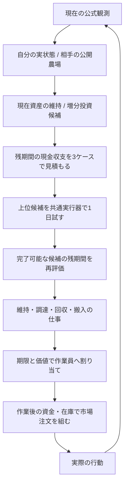

# Kaggriculture Foundation basic v1 — 解法の設計

## 到達点

ゲームモデル、仕事の割り当て、資金管理、投資比較を新規実装した、改善の出発点となるエージェント。
目的は、終了時の現金を増やす判断を実行可能な作業に変換し、その判断が外れた理由を測れるようにすること。
まず再現した不具合を解消する基本版とし、強さの調整は行わない。
v0監査の4種類・両座席8ケースを回帰テストに取り込み、判断と公式処理の両方を確認する。
上位の強さは未達であり、動作確認だけで銀相当とは判断しない。

提出ランタイムは標準ライブラリだけを使う。入口は `agent(observation, configuration=None)`。

## 1. 最適化する問題

行動列を A、観測から分からない将来の需要・相手供給・作業達成率を θ とする。

```text
ゲーム内の目的: J(A, θ) = 終了時の現金
最終的な競技評価: 勝ち + 0.5 × 引き分け

投資の増分価値 ΔJ
= 同じ現在状態から、投資した場合の終了時現金
- 同じ現在状態から、現在の資産を維持した場合の終了時現金

候補の評価値 = 3シナリオの最小ΔJ + 0.25 × 平均ΔJ
採用条件 = 全ケースの資金・作業容量が成立し、最小ΔJ > 25
```

評価式・25の閾値・シナリオの倍率は設計上の初期値。公式仕様でも最適化済みの値でもない。
最小ケースの採用も、考慮していない将来まで保証するものではない。

設備、未成熟の生産物、種、家畜そのものは終了時の現金として加算しない。
売却可能な在庫も、終了前に回収・搬入・市場注文を実行できた分だけが実際の得点になる。
自己生産の小麦は給餌に使った分を在庫から引き、翌日の購入費を減らす。実際の費用と
売却機会費用を同時に支出として足す二重計上は行わない。

## 2. モジュールと責任



| ファイル | 責任 |
|---|---|
| `rules.py` | 固定した公式定数、設定値、費用、生物の初期状態 |
| `state.py` | 観測のコピー、座席、現在日、位置、在庫の正規化 |
| `market.py` | 価格曲線、逐次見積もり、双方の同時注文の処理 |
| `physics.py` | 作業、成長、死亡・逃走、倉庫、日末の状態遷移 |
| `projects.py` | 投資意図、互換性のある空き地・畜舎、初回回収までの設置期限 |
| `jobs.py` | 前提・期限・価値を持つ仕事、調達経路、資源予約、割り当て |
| `forecast.py` | 公開情報に基づく将来仮説と、残期間の現金台帳 |
| `execution.py` | 実戦と予測の両方が呼ぶ作業・市場の実行器 |
| `planner.py` | 候補生成、時間と個数の上限、分岐比較、採否 |
| `controller.py` | 観測からの再構築、投資意図の継続、状態リセット、診断 |

## 3. 公式処理と仮説の境界

ローカルの基準は `kaggle-environments==1.32.7` の Kaggriculture。
ソースと設定のSHAを評価条件・リリースに保存する。
[公式ソース](https://github.com/Kaggle/kaggle-environments/tree/master/kaggle_environments/envs/kaggriculture)
の master と本番の同一性は、この新規実装では再確認していない。

### 正確に再現する層

1. 自分の作業員の処理。種の同時過剰要求はその作物の全要求を無効にする。
2. 市場処理。注文枠ごとに双方の1単位の価格を先に決め、その後双方を処理する。
3. 町の消費。
4. 生産物の腐敗。
5. 日末の生物更新、持ち物の倉庫への移動、作業員の消滅・初期位置への復帰。
6. 終了判定。標準設定で最後に実行される行動は step 718。

購入小麦や新しい雇用者は、市場処理後に初めて利用可能になる。
DROPで倉庫に入れた商品は同じターンの市場で売却できる。
最終日の持ち物を日末の自動搬入に任せると、最後の市場に間に合わない。
世話のボーナスは、その夜の生産後に新しく積まれるという公式順序を守る。

価格は単価×数量で固定せず、各単位の在庫変化・四捨五入・1ドル下限を含めて計算する。
1ドルでの売却が市場在庫を増やさない例外も含める。
一連の売買、雇用、購入、土地取得は、元の注文枠の順序で実行する。

### 将来に関する仮説

| 不確実な項目 | 基本版の扱い | 検証・改良する場所 |
|---|---|---|
| 相手の在庫・持ち物 | 入力として取得しない | 観測APIの境界 |
| 相手の出荷 | 公開生産設備から理想的な生産量を計算し、0.5/1/1.5倍 | `forecast.py` |
| 将来の相手の追加投資 | 未モデル化 | 予測誤差の大きな試合から追加 |
| 将来の店 | 既存店は正確な需要。追加店は8種類の一様期待値と幅 | `forecast.py` |
| 将来の作業達成率 | 0.85/0.95/1.0を初期仮説とする | 実際の未達仕事・移動の測定 |
| 日ごとの売買時刻 | 長期評価は日単位の近似 | 1日の実行試算・公式対戦 |
| 将来の雑草 | 実行試算では新規発生を仮定しない。実戦は最新観測から修復 | 予測誤差を記録 |

`physics.advance` に相手供給・新しい店・雑草を入れる場合は、外生イベントとして明示する。
対戦のseedやリプレイの未来を、提出エージェントに渡さない。

## 4. 生産と投資

基本版は、牛・羊・ガチョウ・5種類の作物から増分投資を生成する。
既存資産を含んだ状態で比較する。資金、餌、賃金、回収可能回数、自分と相手の供給による
値崩れを現金台帳に反映する。購入済みの種・動物にも、初回収穫・搬入・売却が間に合う
設置期限を適用する。期限を過ぎた資材は実在庫に残し、作付け・調達・用地整備を開始しない。
動物の初回収入は翌日の肥料回収とする。設置期限は農夫の日末帰還位置からの移動も含める。
期限判定は投資候補、観測資材の推定、継続する意図、仕事生成、購入処理で共通に使う。

候補は最大8本。粗い3ケース評価後、上位最大2本を1日分の実行器で確認する。
現状維持も同じ実行器で同じ期間試す。試算で資材を購入しても、そのターンの作業には使えない。
配置が完了しない、意図しない不発が起きる、倉庫で捨てる、試算が途中で打ち切られる候補は採用しない。
試算後の実際の資産と資金から、残期間の3ケースを再評価する。

基本版は1日1件の投資で、資産上限20。配置候補は近い互換性のある空き地・空畜舎を使う。
牛と羊は空PASTURE、ガチョウは空COOPを再利用する。使える所有地が尽きた場合に
次の土地代を含める。これらは探索空間を単純にするための制限で、最適な購入速度・配置ではない。
複数投資の組合せ探索は、同じ `Project` と共通実行器の上に追加できる。

## 5. 仕事と雇用

`Job` に対象位置、行動、必要資材、期限、利益または回避損失、指定作業員を持たせる。
給餌・家畜配置は、必要なら倉庫への移動とPICKUPを先行させる。
作付けは共有の種を予約し、その日の水やりが間に合う期限までに限定する。

連続未給餌・未給水で失う危険がある期限間近の仕事は、完遂できる作業員を先に対応付ける。
対応できる人数が少ない仕事を優先し、担当の入れ替えで同時に守れる仕事数を増やす。
担当未確定のまま他の作業員へ任せたことにしない。餌は1仕事に必要な不足分だけPICKUPし、
別の担当者の餌を持ち去らない。残りの割り当ては期限・価値・移動込みの所要時間に基づく貪欲法。
実際の作業員の処理順に、分離した状態で1手を実行して資源を予約する。
失敗した予約は状態を戻す。予測上も効果のある行動だけを返す。

作物の寿命時刻は腐敗の開始であり、収穫禁止の時刻ではない。現在の正の収量と
隔ターンの腐敗から最後に収穫できる時刻を求める。最終配送と日末の期限も合わせて使う。
多年作物は収穫可能になった後も、水やりの仕事を残して次の生産を維持する。

雇用は、作業員が1人増えたときに、その日の達成可能な仕事の価値が増えるかで判断する。
実際のFibonacci費用、残り時間、運転資金を確認する。最大10人の作業員を初期の上限とする。
この雇用見積もりは近似で、仕事間の依存や共同作業の全組合せを解いてはいない。
さらに、作業と既存の市場注文を反映した分岐で雇用を試し、次ターンの共通割り当て処理が
新しい作業員に実行可能な仕事を渡せる場合だけ支払う。容量の概算だけによる空雇用を防ぐ。

## 6. 市場、資金、終盤

注文生成前に、作業で変わった倉庫・所持品を再計算する。
餌は原則2日分を確保し、投資には餌と想定賃金の資金余裕を求める。
非公開の同時注文で売却額が変わるため、購入資金として確実に見込む売却収入は1単位1ドルに限定する。
給餌用小麦の価格上限は、相手の注文数と倉庫容量から最大購入量を保守的に見積もる。
注文上限を超える予定を黙って送らず、重要な調達用の枠を確保する。

基本版の既定は、餌を除く余剰在庫の即時売却。値上がり予測による保有は既定で無効。
終盤は餌も売却対象に戻す。
最終日の水やりは、回収・搬入に間に合う収量増だけを候補にする。
終了までに増分現金を得られない世話・給餌を候補から外す。

## 7. 状態・時間・説明

各ターンの観測から実状態を作り直す。保持するのは未完了投資の意図、直前の予測と診断履歴。
分岐の資金・持ち物・作物状態を次の実戦ターンへ持ち込まない。
入口ごとに独立したControllerを作り、座席変更・stepの巻き戻りで状態をリセットする。

探索時間の初期上限は0.20秒。時間切れでも、現在資産の維持・回収を行う実行器を呼ぶ。
打ち切った試算は完成した試算として扱わない。
Pythonの1サブルーチンの途中を強制中断する仕組みはないため、実測の最大時間で余裕を確認する。

選択・却下した投資、ケース別の増分現金、餌代・賃金・最低資金、作業の担当・期限・前提、
市場注文の採否と資金余裕を診断情報として取り出せる。
実際の観測と直前予測の現金・私有在庫の差も数える。相手の同時注文の影響と、モデルの誤りを調査する入口になる。

## 8. 基本版から上位を目指す順序

1. 公式処理との不一致、未完了作業、回収漏れを減らす。性能調整の前提を固定する。
2. 長期の作業達成率と雇用費の予測を、実測された移動・維持・搬入の損失で校正する。
3. 設備構成に応じた相手供給の幅を校正し、予測誤差の大きいケースを検証用に分離する。
4. 作付けの更新、配置候補、投資速度、赤字設備の維持停止を少数の独立した変更として比較する。
5. 1件の増分投資で改善が再現した後、作物と家畜・土地・人数の小さな組合せを比較する。
6. 未使用seedと未使用の相手設計で評価し、銀境界との関係を確認できる相手群へ進む。

新しい機能は個別の無効化比較を用意する。粗いシミュレーションの予測利益、スターターへの勝率、
他バージョンの公開スコアを、新しいコードの競技強度に置き換えない。

## 9. 基本版の限界

- 長期予測の作業・雇用・出荷時刻は近似。1日の試算だけで全シーズンの実行可能性を保証しない。
- 危険な維持仕事以外は貪欲法。全作業の担当交換・順序交換の最適化は未実装。
- 購入は1件/日で、種を収穫後に自動で再購入する前提は長期評価に入れていない。
- 肥料は販売が基本。肥料使用と販売の機会費用比較は今後の候補。
- 将来の相手の増産、需要の偏り、不採算設備の意図的な撤退は未モデル化。
- 評価相手の出所は記録するが、現段階では銀境界に校正した比較群ではない。

既知の再現不具合の修正と、これらを診断・比較できる構造がbasic v1の完成範囲。
全状態での無欠陥や、全生産物の回収、銀相当の強さは保証しない。
Linuxの梱包試験はユーザー指定により今回実施しない。
